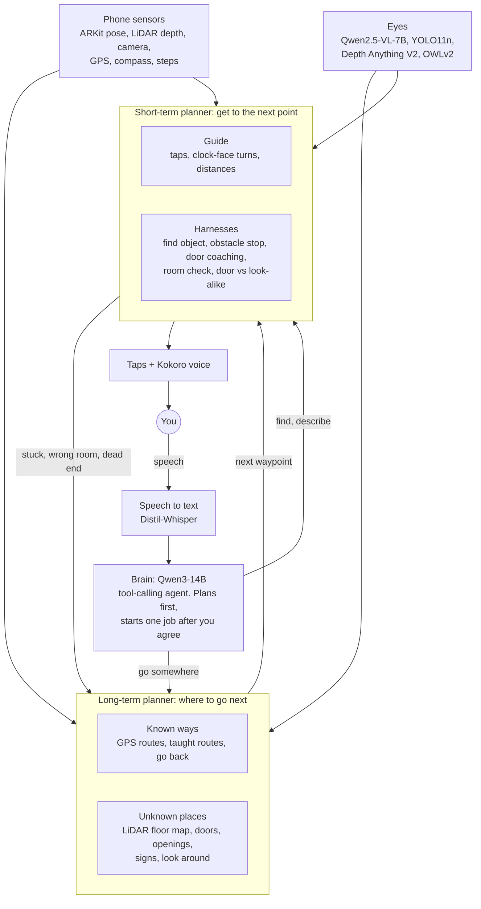

# Pip

Pip is a walking guide for blind people. You put on headphones, hold an iPhone in front of you and say where you
want to go. Pip answers in a short sentence, then guides you mostly with taps. A tap in your left ear means turn
left, and the taps speed up as you get closer to facing the right way. When you're on course it goes quiet or
ticks softly in both ears. It talks only when something changes: a turn, a door, something in your way, arriving.

It works indoors (find the restroom in a building you've never been in, walk a route you taught it at home) and
outdoors (walk to a named place with GPS, then find the entrance with the camera).

The name of the project is ycgsf, short for "you can go so far". Built at Hacktoberfest Hack Day San Diego. This
is a prototype, not a mobility aid. Use it with your cane or dog, not instead of them.

## What's in this repo

```
frontend/      the app itself: index.html, app.js (all guiding logic), ui.js (screens), icons.js, shaders.js
ios/           iPhone shell: a WKWebView that runs frontend/, plus ARKit + LiDAR, camera, mic, GPS and native audio
server/        the model server for the RTX 4090 (app.py), its Windows start and restart scripts
design/        the pen.dev design (untitled.pen), its tokens and GLSL shaders
tools/         deploy.sh (server to the 4090), check_design.py (does the app match the design?), export_shaders.py
graphify-out/  code knowledge graph (see CLAUDE.md)
run.sh         serves frontend/ on http://localhost:5173
```

## How it works



1. **You talk.** The phone's mic is always on. It cuts speech into phrases by loudness and sends each one to the
   server as 16 kHz audio. Distil-Whisper turns it into text. Fillers ("um", "okay") and speech that isn't meant
   for Pip (you talking to someone else, the TV) are dropped.
2. **The brain decides.** Qwen3-14B gets what you said, what the phone knows (GPS, heading, saved spots, taught
   routes) and a set of tools: find places, get a route, follow a taught route, record a route, go to a room or
   object, find an object, describe, look and plan, where am I, go back. It can call up to 5 tools per turn, then
   replies with one sentence and at most one action for the app. For anything that moves you, it tells you the
   plan and waits for "yes".
3. **The long-term planner picks the next point.**
   - *Known ways.* Outdoors: the server finds the place (OpenStreetMap, or Google Maps with a key), the phone gets
     the walking path from Apple Maps, and Pip follows it with GPS and the compass. Indoors: a route you taught by
     walking it once, saved with ARKit's scan of the room so Pip can recognize the room later. Go back reverses
     your trail.
   - *Unknown places.* On a LiDAR iPhone, ARKit builds a floor map while you turn around: a grid of free, blocked
     and unknown 10 cm cells, doors that ARKit itself classifies, and openings at the edge of what's been seen. The
     brain must pick one of those real candidates by id, so it can't invent a door. Signs are read on the phone
     (Apple Vision) and a matching sign wins over a guess. Without LiDAR, Pip takes 8 photos during a slow turn,
     the vision model describes each one, and the brain picks the most promising way.
   - *Room by room.* Anything beyond the room you're in (the restroom down the hall, the lobby, the exit, a place
     outside) is a trip, done one room at a time with `leave_here`. Each hop: you turn around once (Pip maps the
     room and reads signs), it picks a real door or opening and drops a mark (room position and GPS), you walk
     there, and at the next decision point it measures whether you got closer. A way that leads away gets walked
     back to its mark, and the next way is tried. It only judges progress at decision points, because the numbers
     jump around while you walk, and a matching sign overrides the measurements. A hop ends when you're through a
     door, in a different kind of space, in the goal room, or outside. Outside only counts when GPS has been good
     for a few seconds and the camera agrees, because Wi-Fi location can look good indoors.
   - *The brain re-plans after every hop.* The app sends it what was measured ("went through a door, now in a
     hallway, 6 m closer"), and it picks the next step: another hop, `go_to` for the last meters of the goal room,
     the walking route once you're outside, or "you're there". The floor map, the marks and what was tried carry
     over between hops, so a dead end can still be walked back through the door it came from. After 10 hops it
     stops and asks you.
4. **The short-term planner gets you there.** An A* path on the floor map (or the GPS path outdoors) becomes taps
   and short phrases like "Turn left, to 10 o'clock" and "Walk 2 meters, about 3 steps". LiDAR stops you when
   something is close in front. At a door, the vision model reads it once: open or closed, hinged, sliding,
   automatic or revolving, handle side and height, and push or pull from what's visible (hinge knuckles on your side
   mean pull, a push plate or the door stop on your side means push). Pip guides the phone to the handle, says which
   hand and how to open it, and then LiDAR tells it the moment the door opens, because it suddenly sees past it.
   Glass fools LiDAR, so glass and automatic doors keep the camera check. A door that won't open after 45 seconds,
   or that you say is locked, is skipped and Pip finds another way. At the end, OWLv2 finds the object and Pip
   guides your hand ("left, left, up").
5. **It checks before it says you've arrived.** A room counts only when the detector sees proof of it (a toilet
   for a restroom) in 3 frames in a row and the vision model agrees you're inside, not just looking in through a
   doorway. Wrong room, all walls, or going in circles sends it back to the long-term planner to retrace and try
   another way. After 3 backtracks or 6 look-arounds it asks you.

## Models

Everything runs on one RTX 4090 except what Apple does on the phone. All the models are open weights.

| Job | Model | How it runs | License |
|---|---|---|---|
| Brain: conversation, planning, tool calls | [Qwen3-14B](https://huggingface.co/Qwen/Qwen3-14B-GGUF), Q4_K_M | llama.cpp `llama-server` on :8101, thinking off | Apache 2.0 |
| Eyes and quick talk: describe views, doors, room check | [Qwen2.5-VL-7B-Instruct](https://huggingface.co/ggml-org/Qwen2.5-VL-7B-Instruct-GGUF), Q4_K_M + mmproj | llama.cpp `llama-server` on :8103 | Apache 2.0 |
| Speech to text | [distil-whisper/distil-small.en](https://huggingface.co/distil-whisper/distil-small.en) | transformers | MIT |
| Voice | [Kokoro-82M](https://huggingface.co/hexgrad/Kokoro-82M), voice `af_heart` | kokoro-onnx | Apache 2.0 |
| Objects in front of you | [YOLO11n](https://github.com/ultralytics/ultralytics) | ultralytics | AGPL-3.0 |
| How far things are (camera only) | [Depth-Anything-V2-Small](https://huggingface.co/depth-anything/Depth-Anything-V2-Small-hf) | transformers | Apache 2.0 |
| Find any object you name | [OWLv2 base](https://huggingface.co/google/owlv2-base-patch16-ensemble) | transformers | Apache 2.0 |

On the phone, no models of ours: ARKit world tracking and LiDAR scene depth (position, floor map, doors), Apple
Vision text recognition (signs), Apple Maps directions (outdoor path shape and street names), Core Motion (turns
and steps) and Apple's voice as a fallback when the server is slow.

Maps and places: Nominatim and Overpass (OpenStreetMap) and OSM foot routing by default. Set
`GOOGLE_MAPS_API_KEY` on the server to use Google Places and Directions instead.

## Where it runs

| | Phone (`frontend/`, `ios/`) | GPU box (`server/`) |
|---|---|---|
| Hears | mic, phrase cutting | Whisper |
| Thinks | guiding loops in `frontend/app.js` | brain, vision model, `/plan`, `/decide_slam`, `/panorama` |
| Sees | camera frames (~5/s, 640 px), LiDAR, ARKit, sign text | YOLO, depth, OWLv2 (`/local`, `/locate`, `/scan`), `/door`, `/confirm`, `/check_room` |
| Speaks | native audio for taps and voice | Kokoro (`/tts`) |

The phone and the GPU box talk over Tailscale. All sound plays through native iOS audio, because if WebKit plays
audio it switches the audio session to playback-only and the mic stops listening.

## Run it

### Model server

Our server is a Windows PC with an RTX 4090 on our Tailscale network. To ship `server/` to it:

```
tools/deploy.sh
```

It backs up the running `app.py`, copies the new one over SSH, stops every running copy of Pip on that PC (the
scheduled task, its restart loop, every API process and both llama-servers, nothing else), starts it again, and
waits for `/warmup`. Set `PIP_BOX=user@host` to deploy somewhere else.

To set up a new GPU machine by hand:

```
pip install torch --index-url https://download.pytorch.org/whl/cu124
pip install -r server/requirements.txt

llama-server -m Qwen3-14B-Q4_K_M.gguf --port 8101 -ngl 99 -c 12288 --jinja -fa on --cache-ram 0
llama-server -m Qwen2.5-VL-7B-Instruct-Q4_K_M.gguf --mmproj mmproj-Qwen2.5-VL-7B-Instruct-Q8_0.gguf \
  --port 8103 -ngl 99 -c 8192 --jinja -fa on

uvicorn server.app:app --host 0.0.0.0 --port 8100
```

Put `kokoro-v1.0.onnx` and `voices-v1.0.bin` in `tts/` (or point `TTS_DIR` at them). Call `POST /warmup` once so
the first request isn't slow, and `GET /health` to see what's loaded. `--cache-ram 0` on the brain matters: with
idle slots saved to RAM, each new request stalled 4 to 9 seconds. `server/run_pip.bat` is the Windows startup
script and `server/restart_pip.ps1` the restart.

### iPhone

Open `ios/Pip.xcodeproj` in Xcode, pick your team under Signing, and run it on a phone with iOS 17 or later.
`ios/project.yml` is the XcodeGen spec if you'd rather regenerate the project. Pro iPhones with LiDAR get the floor
map; other phones use the 0.5x ultra-wide camera and the gyro for turns. Set the server address in Setup.

### Browser (desk testing)

```
./run.sh
```

Open http://localhost:5173 and press Enter. Point it at your server with `?server=http://<gpu-host>:8100` or in
Setup. With no GPS, add `?lat=32.8801&lon=-117.2340` and use W to walk and A/F to turn.

## Using it

Say things like:

- "Take me to the restroom." / "Where's the kitchen?"
- "Find my keys." / "Where's the door handle?"
- "What's around me?"
- "Remember the way from the couch to the bathroom." Walk it, then "We're here."
- "Walk me to the library." (Pip turns on GPS only when you name a place or say you're outside; from inside a
  building it walks you out first)
- "Get me out of here." / "Where's the exit?"
- "It's locked." (at a door: Pip gives up on it and finds another way)
- "Go back." / "Stop." / "Repeat that."

Listening modes (Setup, or H): always on (default), "Hey Pip" first, or push to talk. With VoiceOver, Magic Tap
pauses or repeats and the Z scrub stops or goes back.

Keys in the browser: hold Space to talk, D what's around, L find, Esc stop, B go back, S save this spot, R repeat,
P pause, T test the taps (left, then right), ←/→ "I turned".

## Working on it

- The design in `design/untitled.pen` is the source of truth for the screens. Change the design first, then the
  code. After any UI change, `python3 tools/check_design.py` must print "matches". After changing a shader in
  `design/shaders/`, run `python3 tools/export_shaders.py`.
- Screens, layout, speech and server replies can be tested at a desk. Guiding can't: pathfinding, finding a room,
  obstacle warnings and ARKit tracking get tested by a person walking with the phone. The app records each trip
  (sensors, photos, floor map); `tools/pull_trip.sh` in the ycgsf repo copies them off the phone and draws them.
- Route following borrows a lot from [Clew](https://github.com/occamLab/Clew). The turn words, tap rates and
  progress tones follow published studies with blind users; the references are in comments in `frontend/app.js`.

## License

MIT, see [LICENSE](LICENSE). The models keep their own licenses (table above). YOLO11 is AGPL-3.0, so check that
before you ship anything built on it.

Built with Claude Code.
